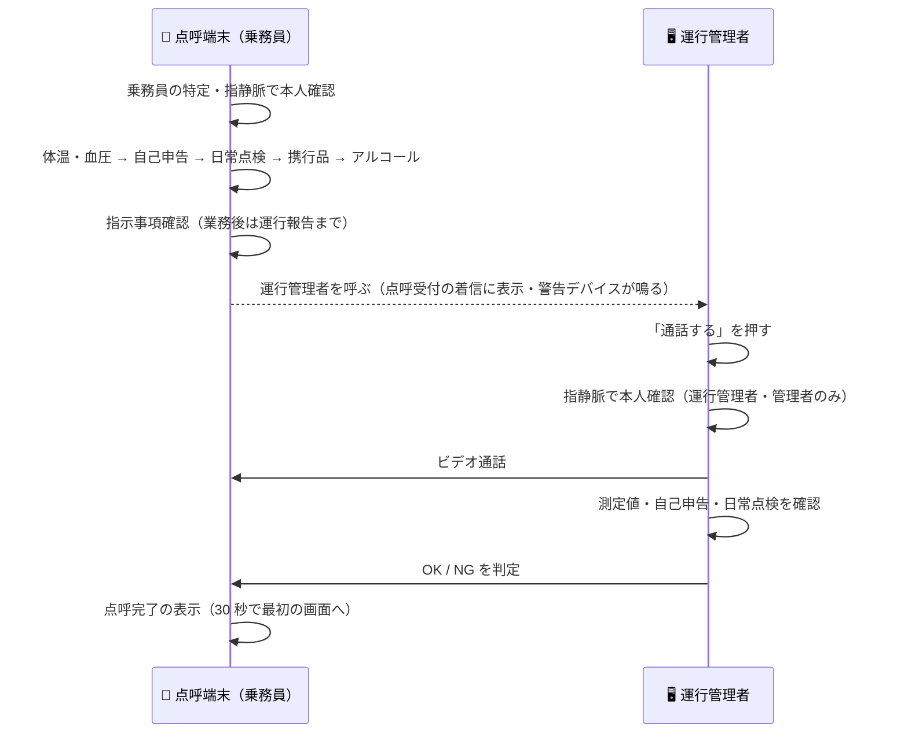

# 遠隔点呼の実施

## 概要

運行管理者が、乗務員とビデオ通話をしながら点呼を行う手順です。

乗務員は点呼端末の「遠隔点呼」タブで点呼の段（本人確認・体温・血圧・自己申告・日常点検・携行品・アルコール・
指示事項確認など）を一人で進めます。最後の確定（業務前は指示事項確認、業務後は運行報告）を終えると、点呼端末が
運行管理者を呼びます。運行管理者は着信に応答し、指静脈で本人確認をしてから通話に入り、測定値と映像を確かめて
OK / NG を判定します。判定を送ると通話が閉じ、点呼が完了します。

乗務員側の操作は [運行者ガイド](../operator/index.md) の「遠隔点呼」を参照してください。

## 全体の流れ

## 準備

- 運行管理者の席の PC に指静脈の読取装置（Vein Station）をつなぎます。通話の前の本人確認に使います
- 運行管理者の指静脈を、乗務員と同じ手順で登録・承認しておきます（[運行者ガイド](../operator/index.md) の「本人確認（指静脈）」）
- 運行管理者の席の PC にカメラとマイクをつなぎ、ブラウザでカメラ・マイクの使用を許可します
- 席に警告デバイスをつないでおくと、着信のときに鳴ります

## Step 1: 着信を受ける

画面上部の役割タブで「点呼受付」を開きます。点呼受付はログインせずに使えます。

点呼受付の「着信」の一覧には、通話を待っている点呼が並びます。遠隔点呼と IT点呼 が 1 つの一覧にまとまり、
行の印（「遠隔」/「IT」）で見分けます。乗務員が最後の確定を終えると「遠隔」の行が現れ、席の警告デバイスが
鳴ります（「着信あり — 遠隔点呼に入ると止まります」）。

「遠隔」の行の「通話する」を押します。

!!! warning "着信には 30 秒以内に応答してください"
    乗務員の点呼端末は、運行管理者が通話に出ないまま 30 秒が過ぎると最初の画面に戻り、着信の一覧から消えます。

!!! note "運行管理者の画面から受ける場合"
    運行管理者の画面（ログインが必要です）の「遠隔点呼」タブでも受けられます。「接続待ちデバイス」の一覧から
    デバイスをクリックすると、同じ手順で通話が始まります。

## Step 2: 運行管理者の本人確認（指静脈）

「点呼開始前の確認」が表示されます。読取装置に指を置くと、登録済みの指静脈から本人が特定され、通話が始まります。
社員番号の入力はありません。

- 運行管理者または管理者の権限が無い人の場合は「○○さんには運行管理者の権限がありません」と表示され、通話は始まりません
- 「指静脈が一致する人が見つかりません。もう一度置いてください」と表示された場合は、指を置き直してください
- やめる場合は「キャンセル」を押します

確認した運行管理者が、その点呼の判定者として記録されます。

## Step 3: ビデオ通話で確認する

通話は全画面で表示されます。画面の下に、その点呼の内容が表示されます。

| 項目 | 確認する内容 |
|------|-------------|
| アルコール | 検知の有無と測定値（mg/L） |
| 体温・血圧・脈拍 | 業務前に測った値 |
| 自己申告 | 疾病・疲労・睡眠不足で「はい」と答えた項目（無ければ「異常なし」） |
| 安全判定 | 安全運転判定の合否と、不合格の項目 |
| 日常点検 | 「全項目OK」か「NG あり」か |
| 直近労働時間 | 直近 3 日の拘束・運転・荷役・深夜の時間 |
| 担当管理者 | 点呼の予定に登録された運行管理者 |

- 「運転者情報」を押すと、乗務員の情報を開けます
- 乗務員の点呼端末に拠点カメラが紐づいている場合は、その映像も表示されます
- 自動点呼の途中で血圧が測れずに切り替わってきた点呼には「自動点呼から切替」の印が付きます。血圧は通話の中で確かめてください

映像で本人であることと顔の表情を確かめ、必要な指示を口頭で伝えます。

## Step 4: 判定して通話を閉じる

画面下の「OK」または「NG」を押します。

- **OK**: そのまま判定が記録されます
- **NG**: 理由と代替措置の内容（どちらも任意）を入力し、「NG として記録する」を押します

判定を送ると通話が閉じ、点呼受付の一覧に戻ります。点呼は OK・NG のどちらでも「完了」となり、判定・理由・
判定した運行管理者が点呼の記録に残ります。乗務員の点呼端末には「点呼完了」と判定が表示され、30 秒で最初の画面に
戻ります。

!!! info "乗務員が最後の確定をするまでは判定できません"
    自動点呼の途中で遠隔点呼に切り替わった点呼は、体温・血圧の段から通話がつながります。この場合、乗務員が
    最後の確定（指示事項確認・運行報告）を終えるまで「乗務員が最後の確定 (指示確認・運行報告) をするまでお待ちください」
    と表示され、OK / NG は押せません。確定すると押せるようになります。

## 運行管理者が出られなかった場合

乗務員の点呼端末には、運行管理者を呼んでいる間「運行管理者が出ないので点呼をやめる」が表示されます。乗務員が
押すと、その点呼は「運行管理者が通話に出なかったため乗務員が中止」の理由で中止として記録されます。

## 通話中に通信が切れた場合

乗務員の点呼端末には、通話の下に「再接続」と「終了」が表示されます（自動では再接続しません）。乗務員が「再接続」を
押してつなぎ直します。運行管理者側は「通話終了」で一度閉じ、点呼受付の一覧からもう一度「通話する」を押してください。

!!! note "IT点呼 との同時の通話"
    遠隔点呼と IT点呼 は同じカメラ・マイクと指静脈の読取装置を使うため、片方の通話中はもう片方に応答できません。
    「IT点呼の通話中です。終わってから応答してください」と表示された場合は、通話を終えてから応答してください。

!!! note "ネットワーク要件"
    遠隔点呼にはカメラ・マイクの権限と安定したネットワーク接続が必要です。

## 関連資料

国土交通省が定める遠隔点呼の実施要件（運用・機器システム・施設環境）は [遠隔点呼 要件チェックリスト](remote-tenko-checklist.md) を参照してください。
